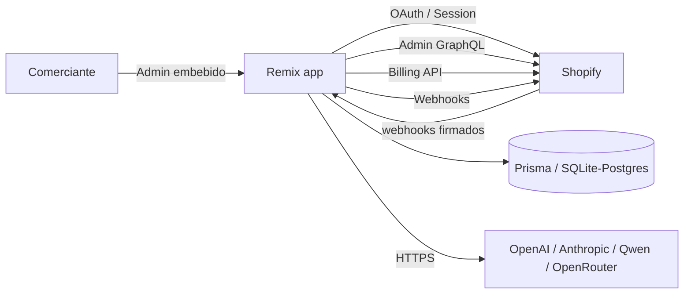
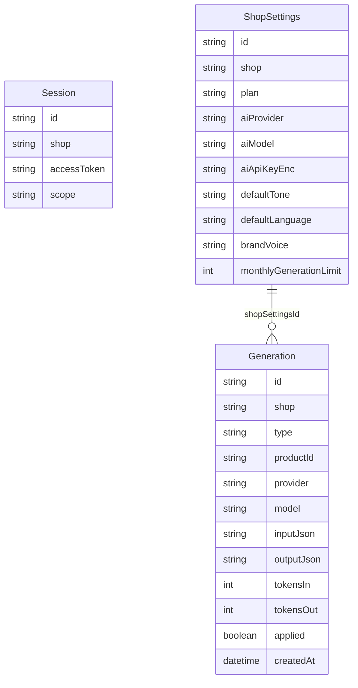
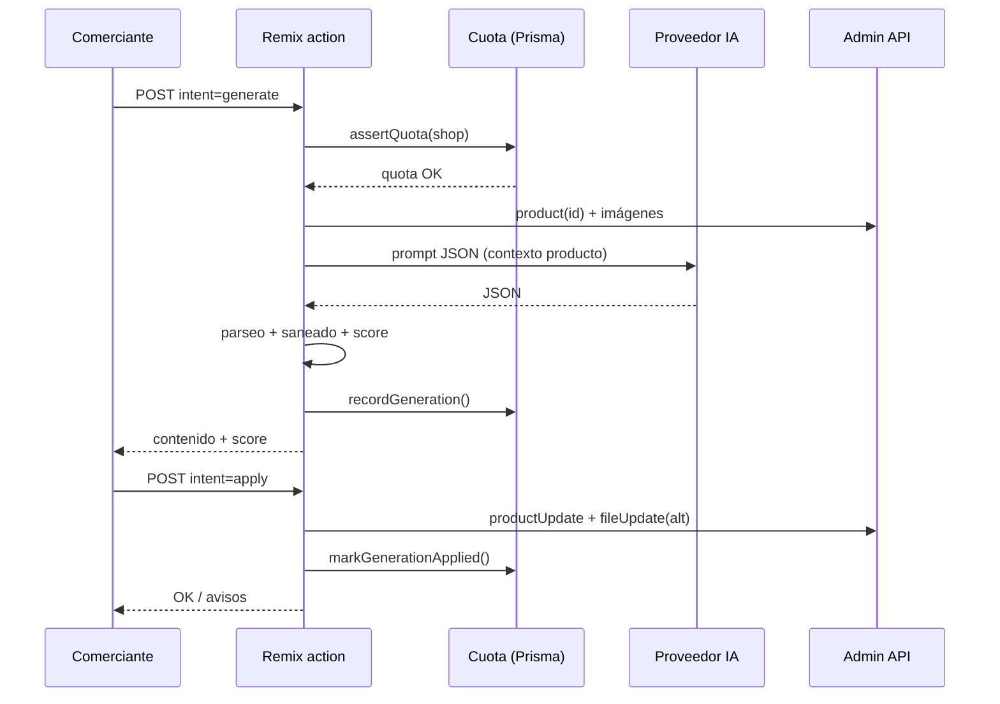

# Arquitectura — ShopGenius AI

## 1. Vista general

- **Remix** sirve la app embebida y ejecuta loaders/actions en el servidor.
- **App Bridge** mantiene la app dentro del admin y aporta navegación y toasts.
- **Polaris** define la interfaz (componentes oficiales de Shopify).
- **Prisma** guarda sesiones, ajustes por tienda, historial y cuotas.
- **Admin GraphQL** lee/escribe productos, SEO, tags e imágenes.
- **Billing API** gestiona la suscripción recurrente.
- **Proveedor de IA** se llama por HTTP desde el servidor; las claves nunca
  llegan al navegador.

## 2. Modelo de datos

- **Session**: la gestiona `PrismaSessionStorage`; no se toca a mano.
- **ShopSettings**: 1 fila por tienda (plan, IA, voz de marca, override de límite).
- **Generation**: auditoría de cada llamada a IA, insumo de cuotas y del historial.

## 3. Flujos

### 3.1 Instalación

1. Shopify abre `https://app/auth?shop=...`.
2. `authenticate.admin` redirige al consentimiento OAuth con los scopes.
3. Callback → se guarda la sesión offline en `Session`.
4. Redirección a `/app`, que crea `ShopSettings` con plan Free y trial.

### 3.2 Generación de contenido

### 3.3 Suscripción

1. El comerciante pulsa *Elegir Pro* → `billing.request({ plan: "ShopGenius Pro", isTest })`.
2. Shopify devuelve `confirmationUrl`; la app abre la confirmación en top-level.
3. Tras aprobar, Shopify redirige a `/app/billing?charge_id=...`.
4. `syncBillingState` llama a `billing.check` y actualiza `ShopSettings.plan`.
5. Cada generación comprueba el límite del plan (`resolveGenerationLimit`).

### 3.4 Webhooks

| Ruta | Topic | Acción |
| --- | --- | --- |
| `/webhooks/app/uninstalled` | `app/uninstalled` | Borra sesiones, marca suscripción como desinstalada. |
| `/webhooks/app/scopes_update` | `app/scopes_update` | Actualiza scopes de la sesión. |
| `/webhooks/customers/data_request` | GDPR | Responde 200; no hay datos de clientes. |
| `/webhooks/customers/redact` | GDPR | Responde 200; no hay datos de clientes. |
| `/webhooks/shop/redact` | GDPR | Borra ajustes, historial y sesiones. |

Todos los webhooks se verifican con HMAC por `authenticate.webhook` antes de
ejecutar lógica.

## 4. Decisiones técnicas

| Decisión | Motivo |
| --- | --- |
| Remix + Vite | Framework oficial recomendado por Shopify; SSR y acciones simples. |
| Prisma + SQLite en dev | Cero configuración local; migración trivial a Postgres. |
| HTTP directo a proveedores IA | Menos dependencias, soporte multi-proveedor y control de errores. |
| Prompts que exigen JSON | Salida parseable y validable; fallback si el modelo falla. |
| Saneado de HTML propio | El contenido se inyecta en la tienda; hay que eliminar scripts/eventos. |
| Cuota por número de generaciones | Fácil de explicar y de medir; los tokens se registran para costes. |
| Modo demo | Permite probar y revisar la app sin claves ni coste. |
| Textos en español | Mercado inicial; el contenido generado soporta 6 idiomas. |

## 5. Límites y escalado

- Las generaciones se ejecutan dentro de la request (sin cola). Los lotes están
  acotados a 20 productos para no superar timeouts.
- Para catálogos grandes (v1.1): cola (BullMQ/SQS), workers y webhooks de
  progreso.
- SQLite sirve para desarrollo; en producción se requiere Postgres por
  concurrencia y backups.

## 6. Observabilidad

- `GET /healthz` devuelve estado, versión de API y timestamp.
- Errores de proveedor y de facturación se registran con `console.error`
  (integrar Sentry en producción).
- Cada generación guarda proveedor, modelo, tokens de entrada/salida y estado.
