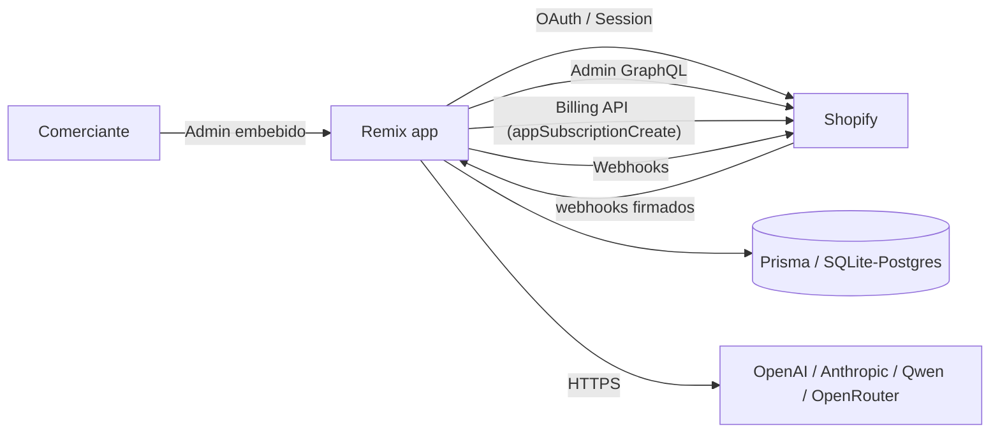
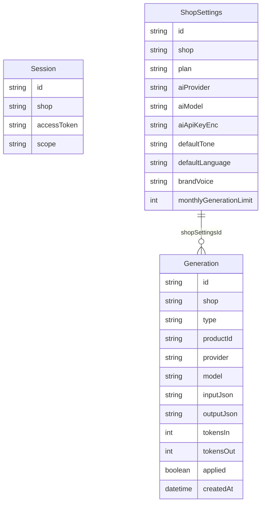
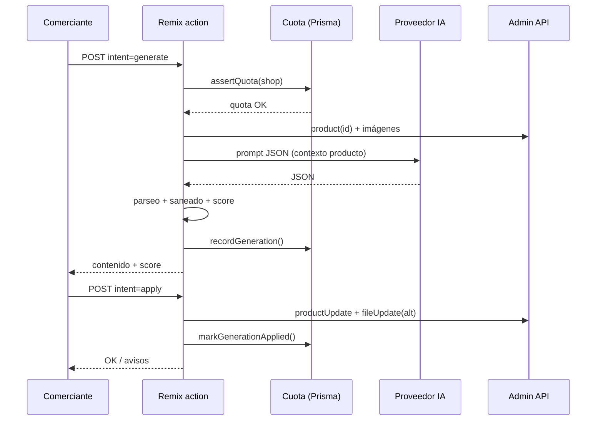

# Arquitectura — ShopGenius AI

## 1. Vista general

- **Remix** sirve la app embebida y ejecuta loaders/actions en el servidor.
- **App Bridge** mantiene la app dentro del admin y aporta navegación y toasts.
- **Polaris** define la interfaz (componentes oficiales de Shopify).
- **Prisma** guarda sesiones, ajustes por tienda, historial y cuotas.
- **Admin GraphQL** lee/escribe productos, SEO, tags e imágenes.
- **Billing API** (Admin GraphQL: `appSubscriptionCreate`, `appSubscriptionCancel`)
  gestiona la suscripción recurrente. En modo prueba los cargos se crean con
  `test: true` (ver §3.5).
- **Proveedor de IA** se llama por HTTP desde el servidor; las claves nunca
  llegan al navegador.

## 2. Modelo de datos

- **Session**: la gestiona `PrismaSessionStorage`; no se toca a mano.
- **ShopSettings**: 1 fila por tienda (plan, IA, voz de marca, override de límite).
- **Generation**: auditoría de cada llamada a IA, insumo de cuotas y del historial.

## 3. Flujos

### 3.1 Instalación

1. Shopify abre `https://app/auth?shop=...`.
2. `authenticate.admin` redirige al consentimiento OAuth con los scopes.
3. Callback → se guarda la sesión offline en `Session`.
4. Redirección a `/app`, que crea `ShopSettings` con plan Free.

### 3.2 Generación de contenido

### 3.3 Suscripción

1. El comerciante pulsa *Elegir Pro* → la action llama a `createSubscription`
   → mutación `appSubscriptionCreate` (nombre `ShopGenius Pro`, 49 EUR,
   `EVERY_30_DAYS`, `test: BILLING_TEST_MODE`).
2. Shopify devuelve `confirmationUrl`; la app la abre en top-level (`_top`).
3. Tras aprobar, Shopify devuelve al comerciante a la app (`returnUrl` =
   `/app/billing` dentro del admin).
4. `syncBillingState` consulta `currentAppInstallation.activeSubscriptions` y
   actualiza `ShopSettings.plan`. **Shopify es la fuente de verdad**: sin cargo
   activo la tienda vuelve a Free; si Shopify no responde, **no se degrada** el
   plan.
5. El webhook `app_subscriptions/update` mantiene el plan sincronizado entre
   visitas (solo una suscripción `ACTIVE` concede plan; el aviso de una
   suscripción anterior no tumba la nueva).
6. Cada generación comprueba el límite del plan (`resolveGenerationLimit`).
7. Cancelar → `appSubscriptionCancel` y vuelta a Free.

La lógica de decisión es pura y está testeada: `billing-core.ts` y
`webhook-logic.ts`.

### 3.5 Modo prueba / modo real

`app/config.server.ts` es la única fuente de verdad:

- `APP_MODE` = `test` (por defecto) | `live`.
- `BILLING_TEST_MODE` = `true` (por defecto) | `false`.
- Los cargos son **reales solo si `APP_MODE=live` Y `BILLING_TEST_MODE=false`**.
  Cualquier otra combinación (incluidas variables ausentes o mal escritas) deja
  los cargos como *de prueba*.
- En modo real, `pickActiveSubscription` ignora las suscripciones de prueba.

### 3.4 Webhooks

| Ruta | Topic | Acción |
| --- | --- | --- |
| `/webhooks/app/uninstalled` | `app/uninstalled` | Borra sesiones, marca suscripción como desinstalada. |
| `/webhooks/app/scopes_update` | `app/scopes_update` | Actualiza scopes de la sesión. |
| `/webhooks/app_subscriptions/update` | `app_subscriptions/update` | Sincroniza el plan (ver §3.3). |
| `/webhooks/compliance` | `customers/data_request`, `customers/redact`, `shop/redact` | Los dos primeros responden 200 (no hay datos de clientes); `shop/redact` borra ajustes, historial y sesiones. |

Los webhooks obligatorios de privacidad se declaran con `compliance_topics` en
`shopify.app.toml` y llegan a un único endpoint. Todos se verifican con HMAC por
`authenticate.webhook` antes de ejecutar lógica.

## 4. Decisiones técnicas

| Decisión | Motivo |
| --- | --- |
| Remix + Vite | Framework oficial recomendado por Shopify; SSR y acciones simples. |
| Prisma + SQLite en modo prueba | Cero configuración local; migración a Postgres cuando se pase a modo real. |
| Billing API directa (`appSubscriptionCreate`) | Control total del flag `test` y del retorno; sin depender de helpers que lanzan redirecciones. |
| Modo prueba por defecto | Indicación de dirección: todos los proyectos en prueba hasta decidir la venta. |
| HTTP directo a proveedores IA | Menos dependencias, soporte multi-proveedor y control de errores. |
| Prompts que exigen JSON | Salida parseable y validable; fallback si el modelo falla. |
| Saneado de HTML propio | El contenido se inyecta en la tienda; hay que eliminar scripts/eventos. |
| Cuota por número de generaciones | Fácil de explicar y de medir; los tokens se registran para costes. |
| Modo demo | Permite probar y revisar la app sin claves ni coste. |
| Textos en español | Mercado inicial; el contenido generado soporta 6 idiomas. |

## 5. Límites y escalado

- Las generaciones se ejecutan dentro de la request (sin cola). Los lotes están
  acotados a 20 productos para no superar timeouts.
- Para catálogos grandes (v1.1): cola (BullMQ/SQS), workers y webhooks de
  progreso.
- SQLite sirve para desarrollo; en producción se requiere Postgres por
  concurrencia y backups.

## 6. Observabilidad

- `GET /healthz` devuelve estado, versión de API y timestamp.
- `GET /healthz` también informa del modo (`mode`, `billingTestMode`).
- Errores de proveedor y de facturación se registran con `console.error`
  (integrar Sentry en producción).
- Cada generación guarda proveedor, modelo, tokens de entrada/salida y estado.
